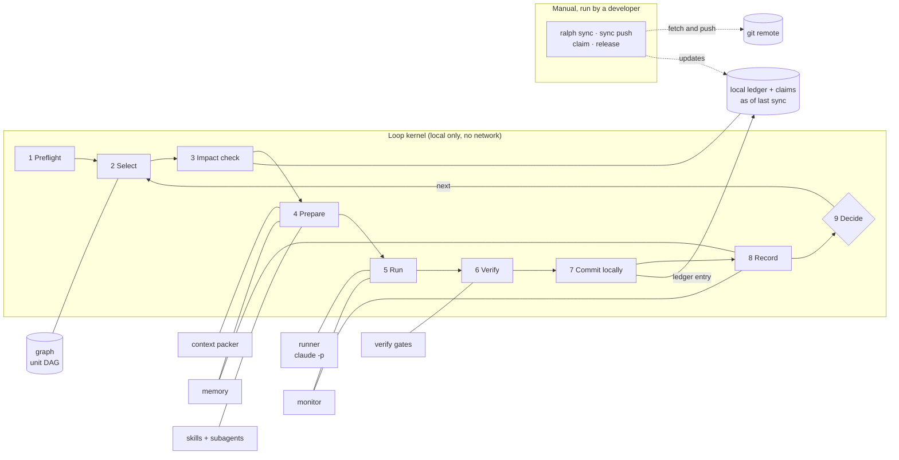
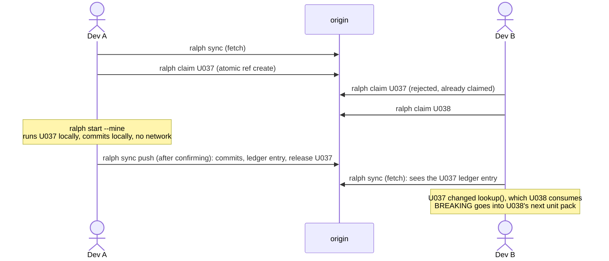

# Ralph Meta-Harness: Plan and Research

**Status:** Draft for review (no code changes yet)
**Date:** 2026-10-25
**Scope:** Rebuild ralph-cli as a meta-harness around Claude Code that does one thing well: run the implementation loop. It also owns what the loop needs: the work graph, context, memory, skills, verification, monitoring and multi-developer sync.

---

## 0. Summary

- **Why the loop gets slow.** Inside a single iteration the context grew from about 25k to **300–575k tokens**. Per-turn model latency tripled (15.8 s → 49.9 s), and **79% of wall time was the model**. Claude Code on 1M-context models only auto-compacts at about **967K tokens** ([model-config](https://code.claude.com/docs/en/model-config)), so it never compacted.
- **The fix in one sentence.** The harness, not the model, decides what goes into context: one unit, its slice of the spec and plan, its dependencies' handoffs and upstream changes. Each iteration is capped at a 200k compaction window plus turn and budget limits, and exploration goes to subagents.
- **Prove it before building it.** A 1–2 day experiment ([P-1](#p-1-quick-win-experiment-on-todays-loop)) first applies the cheapest fixes to today's bash loop and measures real units against the [success targets](#success-targets). The rewrite starts only if the diagnosis holds.
- **Quality is checked, not assumed.** The harness runs the tests itself, rejects skipped or deleted tests, and has a separate read-only reviewer check each unit's tests against its acceptance criteria.
- **What the harness becomes:**
  - A small **loop kernel** with 9 explicit phases. It works only on your machine: it never fetches, pushes, rebases or claims.
  - **Modules** plugged into those phases: work graph, context packer, memory, skills, agent runner, gates, monitor, sync.
  - Everything else (critique, retro, deploy) becomes optional **extensions** outside the kernel.
- **Graph-based execution.** The plan is compiled into a dependency graph of units. The scheduler runs ready units in graph order, optionally in parallel worktree lanes. An impact graph (units ↔ files ↔ interfaces) tells each developer how others' changes affect their in-flight work.
- **Multi-developer sync is manual.** Nothing reaches or leaves the remote unless a developer runs a command (`ralph sync`, `ralph sync push`, `ralph claim`, `ralph release`). Claude Code has nothing built in for coordinating developers: agent teams don't run under `-p`, and cross-session messaging is limited to one OS user ([agent-teams](https://code.claude.com/docs/en/agent-teams), [cross-session-messaging](https://code.claude.com/docs/en/cross-session-messaging)). So ralph uses git itself:
  - **Claims:** atomic git refs, created and released by hand.
  - **A change ledger:** one file per completed unit, published when you push.
  - **An impact digest:** built from what you last synced and injected into each iteration. The loop only reads it.
- **Borrowed, not reinvented.** Ideas from ralph-harness, ralphex, Beads, Spec Kit, Taskmaster and Kiro are folded in ([§21](#21-prior-art-ideas-we-borrow)).
- **Decisions needed from you** are listed in [§19](#19-decisions-needed).

### Success targets
How we'll know it worked. The baselines come from the measured iterations in [§1](#1-what-we-measured). The targets are checked twice: in [P-1](#p-1-quick-win-experiment-on-todays-loop) on 1–3 real units, and after P1 on at least 5 real units.

| Metric | Baseline | Target | Measured from |
|---|---|---|---|
| Peak context per iteration | 300k–575k | ≤ 200k in at least 90% of iterations | `peak_context` in `iterations.jsonl` |
| Model seconds per turn | 15.8–49.9 s, rising with context | ≤ 20 s on average | `duration_api_ms / num_turns` |
| Median iteration time | ~38 min | ≤ 25 min | `duration_ms` |
| Median cost per iteration | ~$17.50 | about half (≤ $9) | `total_cost_usd` |
| Main-thread file dumps + searches per iteration | ~56 | ≤ 20 (the rest goes to subagents) | tool counts in the event stream |
| Units reopened after `done` (bugs found later) | measured from the existing logs in P-1 | no increase | unit state history and the ledger |

**Decision rule:** if P-1 misses the first three targets badly, we re-diagnose before building anything. For example, unit difficulty or test time might dominate instead of context.

### Feature breakdown
Every feature, what it does, how you use it, and which delivery phase ([§18](#18-delivery-phases-and-checkpoints)) builds it.

| Area | Feature | What it does | How you use it | Phase |
|---|---|---|---|---|
| **Setup** | Project init | Creates the spec draft, a short `CLAUDE.md` map, config, starter skills, subagents and quiet test scripts. | `ralph init` | P1 |
| | Change requests | Sets up a new feature folder with its spec, plan and units. | `ralph add-cr` | P1 |
| | Migration | Converts an existing ralph project: units built from the checklist, notes split out, the old diary archived. | `ralph migrate --cr N` | P1 |
| | Constitution | A short list of project principles, created once and checked by the reviewer (from Spec Kit). | `ralph init` | P1 |
| | Testable acceptance criteria | Spec and plan prompts write criteria as "WHEN …, THE SYSTEM SHALL …", so each one maps to a test (from Kiro's EARS). | `ralph init`, plan mode | P1 |
| **Loop** | One unit per iteration | Each iteration gives Claude one unit and a fresh context, so context can't pile up. | `ralph start` | P1 |
| | Bounded runs | Caps turns, spend and wall-clock time, and compacts at 200k tokens instead of ~967K. | config, `--max-budget` | P1 |
| | Stop rules | Stops when everything is done, a unit is blocked, progress stalls, the done count drops, or the budget runs out. | automatic | P1 |
| | Ad-hoc tasks | Runs one bounded iteration for work outside the plan, such as a bug fix. | `ralph start --task "…"` | P1 |
| | Completion step | Runs all tests, checks every acceptance criterion, writes a report and tags the release. | automatic at the end | P1 |
| | Dry run | Shows the next unit's context pack and its size without calling Claude. | `ralph start --dry-run` | P1 |
| | Steering | Adds your note, or a must-pass check, to the next unit pack without stopping the loop (from ralph-harness). | `ralph steer "…"` | P1 |
| | Pause to edit | Finishes the current iteration, waits while you edit the plan, then continues (from ralphex). | `ralph pause`, `ralph resume` | P1 |
| **Work graph** | Plan compiler | Turns the plan into a dependency graph of units (dependencies, priority, spec refs, key files). | automatic after planning | P1 |
| | Unit size check | Rejects units with more than 8 key files (suggesting a split), and flags Large units and units that cite many spec sections. | automatic, `ralph graph compile` | P1 |
| | Ready list | Lists the units that can start right now (from Beads). | `ralph ready` | P1 |
| | Discovered work | Issues found during a unit become new linked units. Hash-suffixed IDs mean units added by different developers never clash (from Beads). | automatic | P1 |
| | Complexity analysis | Scores each unit's complexity and proposes splits for the hard ones (from Taskmaster). | `ralph graph compile --analyze` | P2 |
| | Scheduler | Picks the next ready unit in build order. A blocked unit only holds back the units that depend on it. | automatic | P1 |
| | Unit state | One JSON file per unit, written only by the harness, so developers never get merge conflicts on status. | `units/U012.json` | P1 |
| | Unit commands | Changes a unit's state by hand: unblock, reset, add. | `ralph unblock`, `ralph set`, `ralph add-unit` | P1 |
| | Graph view | Draws the units as a diagram coloured by status, with the critical path and who has claimed what. | `ralph graph` | P1 |
| | Parallel lanes | Runs independent units side by side in separate worktrees, then merges them locally in order. | `ralph start --lanes N` | P4, only if needed |
| **Context** | Context pack | Gives Claude only its unit, the spec parts it cites, its dependencies' handoffs, the impact digest, the last failure and skill hints. | automatic | P1 |
| | Spec excerpts | Resolves references like `§4.3` or `AC-012` to the matching spec sections, within a size cap. | automatic | P1 |
| | Hermetic runs | Leaves out your personal MCP servers, plugins, hooks and auto memory, so every run sees the same setup. | automatic | P1 |
| | Cache-friendly prompts | Puts the stable parts first and the changing unit last, so repeated iterations reuse the prompt cache. | automatic | P1 |
| | Exploration subagents | `explorer` and `test-runner` read code and run tests in their own context and return short summaries. | `.claude/agents/` | P1 |
| **Memory** | Unit handoffs | Each finished unit leaves a note of 10 lines or fewer that the units depending on it receive. | automatic | P1 |
| | Learnings inbox | Claude records up to 5 lessons per iteration. | automatic | P2 |
| | Memory review | Promotes repeated lessons into `CLAUDE.md`, path rules, skills or hooks, after you approve each one. | `ralph memory review` | P2 |
| | Size limits | Keeps `CLAUDE.md`, rules and notes within budget, and moves old diaries to an archive Claude never loads. | `ralph memory lint`, also checked at start | P2 |
| | Memory decay | Summarizes notes from old finished units to one line, so history stays cheap (from Beads). | automatic | P2 |
| | Graph memory (optional) | Plugs in a graph store, such as Cognee, for searching past lessons and changes. | config | later |
| **Skills and stack knowledge** | Starter stack skills | Generates skills for your chosen stack (e.g. FastAPI conventions, migrations) for you to review. | `ralph init` | P2 |
| | Skill suggestions | Lists the 1–3 skills relevant to each unit in its context pack. | automatic | P2 |
| | Path-scoped rules | Rules for one area of the code load only when Claude touches files there. | `.claude/rules/` | P2 |
| | Pinned library docs | Docs for your exact library versions, searched by the `explorer` subagent instead of loaded up front. | `docs/vendor/`, `.ralph/mcp.json` | P2 |
| | Skills refresh | Flags skills and docs that went stale after a dependency upgrade. | `ralph skills refresh` | P2 |
| | Skill checks | Lints skills (size, description) and runs 3 test scenarios per skill. | `ralph skills lint`, `ralph skills eval` | P2 |
| | Team sharing | Shares skills through git, or as a project plugin. | commit, or a plugin | P2 |
| **Agent runner** | Single runner | The only code that starts Claude: the CLI by default, the Agent SDK as an option. | internal | P1 |
| | Structured result | Claude ends each unit with a schema-checked JSON result: status, handoff, lessons, interface changes. | automatic | P1 |
| | Guardrail hooks | Stops Claude from accidentally committing, pushing, fetching, or editing harness state and locked paths. Not a security boundary: use a container or sandbox for that. | automatic | P1 |
| | Permission modes | Sets how much Claude may do without asking: bypass with guardrails, a strict allowlist, the OS sandbox, or a container. | config | P1 |
| | Retries | Backs off and retries on API errors, and stops cleanly at usage limits. | automatic | P1 |
| | Version pinning | Checks the Claude Code version at start, and replays recorded real event streams in tests, so a CLI update can't silently break the loop. | config `runner.claude_version`, `ralph doctor` | P1 |
| **Verification** | Harness-run tests | The harness runs the tests itself, choosing them by unit type, instead of taking Claude's word. | config `[gates]` | P1 |
| | Baseline check | Refuses to start on a codebase whose tests already fail. | automatic | P1 |
| | Failure handling | Retries a flaky test once. Infrastructure errors (Docker, ports) don't count against the unit. | automatic | P1 |
| | Quiet test output | Tests print ✓ when they pass and only the failing part when they don't. | test scripts | P1 |
| | Test-integrity check | Fails the unit if tests were deleted or skip markers were added, without asking a model. | automatic | P1 |
| | Per-unit review | A separate read-only reviewer checks the unit's tests against its acceptance criteria before the unit counts as done. | automatic (P0 and Large units by default, or all) | P1 |
| | Frozen paths | Fails a unit that changes files marked as frozen, such as shipped migrations or CI config (from ralph-harness). | config `[verify] frozen` | P1 |
| | Health check | A quick check before each iteration; if the tree is broken, fixing it comes first (from ralph-harness). | config `[verify] health` | P1 |
| | Saved attempts | When a unit is blocked or reset, its work is saved under `refs/ralph/rejected/` before the tree is cleaned, so nothing is lost (from ralph-harness). | automatic | P1 |
| | Convergence check | After the last unit, compares the implementation with the spec and turns any gaps into new units (from Spec Kit). | automatic at the end | P1 |
| **Version control** | Own-path commits | Commits only the files the run changed, one local commit per unit. | automatic | P1 |
| | Branch guard and lock | Won't run on `main`, or with two loops at once. | automatic | P1 |
| **Monitoring** | Iteration record | Logs every iteration: unit, turns, cost, time, peak context, compactions, test results. | `log/iterations.jsonl` | P1 |
| | Run folders | Saves everything about each iteration (prompt, settings, event stream, result, test log) for debugging. | `log/<run>/<iter>/` | P1 |
| | Live watch | Shows the current unit, turn count, a context gauge, cost so far, and alerts. | `ralph watch` | P1 |
| | Live alerts | Warns on high context, compaction, retries, rate limits, repeated identical commands, or long silence. | automatic | P1 |
| | Status and trends | Shows progress plus per-unit time, cost and context trends. | `ralph status` | P1 |
| | Web dashboard | The live view in a browser, with streaming updates (from ralphex). | `ralph watch --serve` | P2 |
| | Notifications | Webhook, Slack or a script on stop, block, usage limit or completion. A failed notification never affects the loop (from ralphex). | config `[notify]` | P2 |
| | Team dashboards (optional) | Sends Claude Code's built-in telemetry to a shared dashboard. | config `[telemetry]` | P5 |
| **Team sync (manual)** | Sync | Downloads teammates' work, shows what affects you, and rebases only if you agree. | `ralph sync` | P3a |
| | Publish | Shows what will be pushed, and pushes only after you confirm. | `ralph sync push` | P3a |
| | Change ledger | Records who changed what for every finished unit: files (exact) and interfaces (best-effort). | automatic, `.ralph/ledger/` | P3a |
| | Impact check | Each iteration reads your last-synced data. Breaking or overlapping changes go into Claude's context, and a conflict stops the loop. | automatic, read-only | P3a |
| | Team views | Shows who is working on what, recent changes, and what affects a unit. | `ralph team`, `ralph changes`, `ralph impact` | P3a |
| | Pull requests (optional) | Opens a draft PR per unit. | `ralph pr` | P3a |
| | Claims | Reserves units so two developers don't build the same thing. Claims expire if left alone. | `ralph claim`, `ralph release` | P3b, only if needed |
| | Locks | Reserves files that only one person should change at a time, such as migrations or schema. | `ralph lock`, `ralph unlock` | P3b, only if needed |
| **Extensions** | Plan critique | An expert review of the plan, plus a bounded fix loop. | `ralph critique`, `ralph refine-plan` | P5 |
| | Retro | A post-build review and draft release notes. | `ralph retro` | P5 |
| | Deploy | Drafts of the deploy plan, runbook and rollback, plus a review. | `ralph deploy` | P5 |

---

## 1. What we measured

From 36 real iterations of a production project driven by the current ralph (Sep 2026). The project and its paths are anonymized here.

| Evidence | Value |
|---|---|
| Per iteration | 100–340 turns, 25–257 min, $10–66, ≈1 unit completed |
| Context inside one iteration | ~25k at start → **300k–575k peak**, **0 compactions** |
| Model's share of wall time | **79%**, so tests and Docker are not the bottleneck |
| Model seconds/turn vs peak context | <200k: **15.8 s** · 200–300k: 19.5 · 300–400k: 29.0 · >400k: **49.9 s** |
| What filled the context | Bash file dumps 57% (source code 45% of those), searches 14% |
| Delegation | 1,216 dumps + 791 searches in the main thread vs **40** subagent calls in total |
| State files | progress log 5,916 lines (~107k tokens), plan 3,862 lines, AGENTS.md 891 lines |
| Not hermetic | every run loaded 104 tools, 13 personal MCP servers, a memory plugin's hooks, 22 skills |

**Root causes:**
1. **The compaction threshold is effectively off.** With the default (~967K on 1M models), nothing bounds context inside an iteration. Every turn re-processes everything read so far.
2. **Exploration happens in the main context** instead of subagents, which should return 1–2k-token summaries ([Anthropic, context engineering](https://www.anthropic.com/engineering/effective-context-engineering-for-ai-agents)).
3. **The model has to re-read growing files** (spec, plan, progress) to find its own unit.
4. **State files turned into diaries.** Nothing enforces size budgets, and the docs advise "target under 200 lines per CLAUDE.md file" ([memory](https://code.claude.com/docs/en/memory)).
5. **Runs inherit the developer's personal Claude environment.**
6. **Units are oversized** (11–95 files changed), and the prompt is open-ended ("fix every failure, including unrelated ones").

---

## 2. Design principles (with sources)

| # | Principle | Source |
|---|---|---|
| P1 | **Context is a finite budget.** Load "the smallest possible set of high-signal tokens" and fetch the rest just-in-time through lightweight identifiers. | [Effective context engineering](https://www.anthropic.com/engineering/effective-context-engineering-for-ai-agents) |
| P2 | **One unit per session, a fresh context each time.** State lives on disk and git is the handoff. | [Effective harnesses for long-running agents](https://www.anthropic.com/engineering/effective-harnesses-for-long-running-agents), [Ralph](https://ghuntley.com/ralph/) |
| P3 | **The harness owns state.** The agent edits only a status field, and machine state is JSON because the model is "less likely to inappropriately change or overwrite" it. | Long-running harnesses post |
| P4 | **Deterministic sensors outside the model.** The harness runs the tests itself, and passing output is collapsed to ✓. | [Böckeler, harness engineering](https://martinfowler.com/articles/harness-engineering.html), [HumanLayer backpressure](https://www.humanlayer.dev/blog/context-efficient-backpressure) |
| P5 | **Subagents are for context control.** The main context acts as a scheduler. | Context engineering post; [sub-agents](https://code.claude.com/docs/en/sub-agents) |
| P6 | **Stopping conditions and ground truth at every step.** | [Building effective agents](https://www.anthropic.com/engineering/building-effective-agents) |
| P7 | **Trace everything.** "Adding full production tracing let us diagnose why agents failed"; token usage "explains 80% of the variance". | [Multi-agent research system](https://www.anthropic.com/engineering/multi-agent-research-system) |
| P8 | **Use the simplest pattern that works.** Parallelism costs tokens (multi-agent ≈ 15× chat), and coding has "fewer truly parallelizable tasks than research". | Multi-agent research system; Building effective agents |
| P9 | **Hermetic, reproducible runs.** The agent sees the same config every time, independent of a developer's personal setup. | [Agent SDK hosting](https://code.claude.com/docs/en/agent-sdk/hosting), [headless](https://code.claude.com/docs/en/headless) |

---

## 3. Scope: what the harness is and isn't

**It is** a loop kernel plus the modules the loop needs:

| Module | Job (single responsibility) |
|---|---|
| `kernel` | Runs the 9-phase iteration state machine and applies the stop rules. It contains no business logic and makes no network calls. |
| `graph` | Compiles the plan into a unit DAG, schedules ready units, analyses impact, renders the graph. |
| `context` | Builds the per-unit context pack within a token budget. |
| `memory` | Owns unit notes and handoffs, the learnings inbox, promotion and pruning, and size lint. |
| `skills` | Curates the project skills and subagents, selects them per unit, lints them. |
| `runner` | The **only** code that invokes Claude. It runs bounded, hermetic calls and parses events. |
| `verify` | Runs gate commands, classifies failures, compresses output. |
| `vcs` | Commits locally, only the run's own paths. Manages worktrees and local lane merges. Never pushes. |
| `sync` | The manual sync commands (`sync`, `sync push`, `claim`, `release`), the change ledger, and the read-only impact check the loop uses. |
| `monitor` | Records per-iteration telemetry, live signals and stop rules, `watch`, and optional OTel. |

**It isn't** (these move to optional extensions that reuse `runner` and `graph`): plan critique, refine-plan, retro and deploy workflows. They keep working but don't live in the kernel.

**Non-goals:**
- Replacing CI or code review.
- Hosting a server. Coordination is git-native.
- Automatic sync. The loop never fetches, pushes, rebases or claims; developers sync by hand ([§11](#11-multi-developer-collaboration-manual-sync)).
- Building a general multi-agent framework.

---

## 4. Architecture overview



**Dependency rule:** the kernel depends only on module interfaces. Modules never import each other's internals or the commands. Commands are thin: they parse arguments, build a `Kernel`, and run it.

---

## 5. The loop kernel: phase by phase

| # | Phase | Module | What happens | On failure |
|---|---|---|---|---|
| 1 | **Preflight** (once per run) | kernel, vcs, verify | Checks that `claude` and git exist. Takes a run lock. Branch guard: no running on the default branch or a detached HEAD unless `--allow-main`. Snapshots dirty paths that already exist. Runs the gates once as a **baseline**. Makes no network calls. | Stop with an actionable message. If the baseline is red, stop (or `--gates-advisory`). |
| 2 | **Select** | graph | Builds the ready set and picks a unit (see [§6.2](#62-scheduling)). In team mode it picks only units you have claimed. | No eligible unit: stop and list the blocked units and unmet dependencies. |
| 3 | **Impact check** (local, read-only) | sync | Reads the ledger entries and claims already on your machine from your last `ralph sync`, and classifies them against the unit ([§11.5](#115-what-the-loop-does-with-synced-data-local-read-only)). | Predicted conflict: stop and ask you to run `ralph sync`. It never fetches or rebases by itself. |
| 4 | **Prepare** | context, memory, skills | Builds the context pack ([§7](#7-context-management-strategy)), writes the run directory and the hermetic settings. | Over budget: trim the lowest-priority sections and warn. |
| 5 | **Run** | runner, monitor | Runs one bounded, hermetic agent call and watches live signals ([§10](#10-monitoring-and-observability)). | API error: retry with backoff. Usage limit: stop. A cap hit records a partial result. |
| 6 | **Verify** | verify | Runs the gates chosen by unit type (retrying a failure once), the test-integrity check, and the per-unit review ([§13](#13-verification-gates)). | An infrastructure error (Docker or port) stops the loop and **doesn't count as an attempt**. A review asking for changes keeps the unit in progress. |
| 7 | **Commit** (local only) | vcs, sync | Commits only the paths this run changed, with the ledger entry in the same commit. **Never pushes.** | A commit hook or GPG failure stops the loop and keeps the work. |
| 8 | **Record** | monitor, memory | Appends to `iterations.jsonl` and updates the unit state, notes and learnings inbox. | Nothing here is fatal: recording is best-effort with a warning. |
| 9 | **Decide** | kernel | Applies the stop rules: all done, caps, stall, regression, budget, nothing eligible. | — |

**Outcome rules (Decide):**
- `done` and gates green → `done`.
- `done` and gates red, or `partial` → `in_progress`. The work stays in the tree for the next attempt.
- 3 counted attempts, or `blocked` → `blocked` with the reason. The unit's work-in-progress is saved under `refs/ralph/rejected/<unit>/<n>` and the tree is cleaned, so nothing is lost and the next unit starts clean.
- Waiting out a usage limit doesn't count as an iteration toward `--max`.
- 3 invalid structured results in a row → stop the loop instead of retrying forever.
- Two compactions or cap hits on one unit → the harness flags it with "split this unit" and proposes a plan edit.

---

## 6. Work graph: graph-based implementation

### 6.1 Data model
- The **plan markdown stays the human-authored source** of unit definitions, and the plan prompt produces it.
- `ralph graph compile` parses it with tolerant parsers that handle bold IDs, multi-line `Depends On`, cross-CR references, `§N.N` spec references and an Implementation Order table. The result is a graph.
- **Unit size check (a hard rule).**
  - When the plan is compiled, a unit with more than 8 `key_files` is rejected with a suggested split. A unit sized `Large`, or citing more than 6 spec sections, is flagged.
  - Spec citations aren't a reliable size signal on their own: real plans cite 11–14 sections per unit as references, not as scope. That's why they only flag (changed during P1).
  - You can override a single unit with `--allow-large U012`.
  - At run time, two compactions or cap hits on one unit trigger the same split proposal ([§5](#5-the-loop-kernel-phase-by-phase)).
  - Small units are what keep the context small; the harness can't rescue an oversized one.
- **Complexity analysis** (P2, `ralph graph compile --analyze`) adds a model-scored complexity per unit and proposes splits for the hard ones. It complements the deterministic size check.
- **Units added during the build:**
  - New units, from `new_units` or `discovered_issues` in a result, get a hash-suffixed ID (`U037-a1b2`) rather than the next number, so two developers adding units at the same time never clash.
  - Each one records `discovered_from: U037`. This is provenance only, not a blocker.
- **`ralph ready`** lists the units that can start right now.
- **Unit state is harness-owned, with one file per unit**: `development/<cr>/units/U012.json`. One file per unit means **no merge conflicts between developers** (each developer touches different files) and no diary growth.

```jsonc
// development/cr2/units/U037.json  (written only by the harness)
{
  "id": "U037", "title": "lookup over MCP", "type": "api", "priority": "P0", "size": "M",
  "depends_on": ["U031", "U033"], "external_deps": ["CR1:U017"],
  "spec_refs": ["§4.3", "AC-012"], "key_files": ["serve/tools/lookup.py"],
  "provides": ["lookup()"], "consumes": ["Index.search"],
  "status": "todo",            // todo | in_progress | done | blocked
  "attempts": 0, "blocker": null,
  "done": null,                // {commit, by, at} when done
  "handoff": ""                // ≤ 10 lines, written from the agent's structured result
}
```
- `PROGRESS.md` becomes a **generated, read-only view** (`ralph status --write`), not a hand-edited log. Humans change state with commands: `ralph unblock U013`, `ralph set U012 --status todo`, `ralph add-unit …`.

### 6.2 Scheduling
- **Ready** means:
  - every `depends_on` unit is `done` on your machine (a teammate's finished unit counts once you've pulled it with `ralph sync`)
  - nobody else holds a claim on it, as of your last sync
  - no hard-locked path clashes

  In team mode the loop picks only from units you've claimed.
- **Order:**
  1. Resume an in-progress unit first.
  2. Then follow the plan's Implementation Order table, falling back to file order.
  3. Break ties with priority, then **critical-path length** (the longest chain of dependents first, which shortens total time).
- **Blocked units block only their dependents.** The scheduler keeps working on independent branches of the graph.

### 6.3 Parallel lanes (optional, `--lanes N`; default 1, max 4)
- **Built only if needed.** Lanes are built in P4 only if real plans show wide independent branches, meaning several ready units at once with no file overlap. Coding has "fewer truly parallelizable tasks than research" ([multi-agent research system](https://www.anthropic.com/engineering/multi-agent-research-system)), merges can conflict, and cost grows with each lane.
- Each lane is a `git worktree add .ralph/wt/<unit> -b ralph/<dev>/<unit> <integration-branch>`. It's created by the harness because Claude Code's `worktree.baseRef` can't name a branch ([worktrees](https://code.claude.com/docs/en/worktrees)).
- The scheduler only runs units in parallel when their planned `key_files` and `provides` don't overlap.
- **Lane merges are local and serialized in topological order:** rebase onto your local integration branch → gates → `git merge-tree` check → merge. Dependent lanes rebase after each merge. Nothing is pushed; publishing stays manual (`ralph sync push` or `ralph pr`).
- Worktrees are cleaned up by the harness, because under `-p` Claude doesn't remove them ([worktrees](https://code.claude.com/docs/en/worktrees)).
- Cost scales with the number of lanes, so `ralph start` prints the projected multiplier.

### 6.4 Impact graph
The edges are: **unit → planned files** (`key_files`), **unit → actual files** (from the ledger), **unit → provides / consumes** (interfaces), and **unit → spec refs**. It answers:
- *"Who is affected by my change?"* Units whose files or consumed interfaces overlap what a ledger entry changed.
- *"What changed that affects me?"* The impact digest, built from your last sync ([§11.5](#115-what-the-loop-does-with-synced-data-local-read-only)).
- *"Can these two run in parallel?"* Overlap prediction.

### 6.5 Visualisation
`ralph graph` renders Mermaid (it shows on GitHub and in VS Code) with nodes coloured by status, the critical path highlighted, active claims labelled with the developer, and blocked chains greyed out. `--json` exports the graph for other tools, such as a graph-memory store.

---

## 7. Context management strategy

### 7.1 Context layers and budgets
| Layer | Content | Budget | Loaded | Written by |
|---|---|---|---|---|
| L0 | Claude Code system prompt + built-in tools + **project** MCP only (tool definitions deferred by tool search) | ~15–20k | always (cached) | Claude Code |
| L1 | `CLAUDE.md` as a **map** (≤200 lines): commands, invariants, pointers. Unscoped rules. | ≤ 4k | always (cached) | human |
| L2 | **Harness contract** via `--append-system-prompt-file`: rules of engagement, the result schema, the delegation policy. No timestamps, so it caches. | ≤ 2k | always (cached) | harness, frozen per run |
| L3 | **Unit pack** (stdin prompt, placed last because it varies) | ≤ 8k | per iteration | harness |
| L4 | Path-scoped rules, skill bodies, files read via subagents or focused ranges, `/memories`-style notes | on demand | just-in-time | curated |

Target: **start an iteration at ≤ 35k tokens and stay under 200k**. In our measurements that is the 15–19 s/turn band.

### 7.2 The unit pack (L3), in this order
1. **Loop header:** unit, attempt number, graph progress, base SHA. Git state is injected by the harness (see 7.5).
2. **The unit's own section** from the plan, verbatim.
3. **Dependencies:** one line each, plus their ≤10-line handoffs.
4. **Spec excerpts:** sections resolved from `§N.N`, `AC-`, `FR-` references against numbered spec headings, capped at ~3k tokens. Anything beyond the cap becomes pointers (`see spec §8.2`).
5. **Plan-level rows citing this unit**, for example a defects table that assigns items to it.
6. **Impact digest** (≤ 3,000 chars), built from what you last synced. The loop never fetches ([§11.5](#115-what-the-loop-does-with-synced-data-local-read-only)).
7. **Relevant learnings:** promoted rules or inbox items whose path globs match the unit's `key_files`, top-k.
8. **Last failure summary:** the failing gate's tail, ~60 lines.
9. **Suggested skills and subagents** for this unit type.

### 7.3 In-iteration controls
- **Compaction window:** `CLAUDE_CODE_AUTO_COMPACT_WINDOW=200000` (or `--autocompact 200k`) ([model-config](https://code.claude.com/docs/en/model-config)). Compaction "clears older tool outputs first, then summarizes" ([how Claude Code works](https://code.claude.com/docs/en/how-claude-code-works)).
- **A compaction is a signal, not a solution** ("compaction isn't sufficient", long-running harnesses post). A PostCompact hook marks the run, and two compactions on a unit means the unit needs splitting.
- **Hard caps:** `--max-turns`, `--max-budget-usd` (client-side estimate, so leave headroom) and a wall-clock timeout, which the harness enforces because there is no timeout flag.
- **Delegation:**
  - Ship a project `explorer` subagent (read-only tools, a cheaper model, returns ≤1.5k-token summaries) and a `test-runner` subagent (returns failures only).
  - The contract says to read a file directly only when about to edit it.
  - Subagents get "a fresh, isolated context window" ([sub-agents](https://code.claude.com/docs/en/sub-agents)).
- **Quiet backpressure:** test scripts print `✓` on success and the failing tail plus fail-fast (`pytest -x -q`) on failure. A hook can also filter test output ([costs](https://code.claude.com/docs/en/costs)).
- **Scope:** "fix unrelated failures" is removed from the prompt. Unrelated failures are reported in the result as `discovered_issues`, and the harness turns them into new units.

### 7.4 Hermetic runs
| Concern | Setting | Why |
|---|---|---|
| Personal MCP servers and connectors | `--strict-mcp-config --mcp-config .ralph/mcp.json` | Only the project's servers (e.g. Playwright) load. |
| Personal plugins, hooks and skills | `--setting-sources project,local` (configurable) | Keeps the project's skills, agents, rules and hooks; drops user-level ones ([SDK features](https://code.claude.com/docs/en/agent-sdk/claude-code-features)). |
| Auto memory | `CLAUDE_CODE_DISABLE_AUTO_MEMORY=1` | It is machine-local, unversioned and loads every session ([memory](https://code.claude.com/docs/en/memory)). Team memory lives in git ([§8](#8-memory-management)). |
| Skills | Don't pass `--disable-slash-commands` (it disables all skills). Use `skillOverrides` to hide specific skills. `disableBundledSkills` was tested and increased first-turn context, so it stays off ([§20](#20-spike-results-p0)). | Keeps the curated project skills ([skills](https://code.claude.com/docs/en/skills)). |
| `--bare` | Not the default | It skips CLAUDE.md, skills and hooks and requires `ANTHROPIC_API_KEY` (no OAuth). Offered as `runner.bare = true` for API-key/CI users. Note that `--bare` "will become the default for `-p`" ([headless](https://code.claude.com/docs/en/headless)), so ralph always passes explicit flags. |

### 7.5 Prompt-cache friendliness
- Claude Code caches in the order system prompt → project context → conversation, with a 1-hour TTL on subscriptions and 5 minutes with API keys ([prompt-caching](https://code.claude.com/docs/en/prompt-caching)).
- **Keep these identical across iterations:** model, effort, tools, MCP set and flags. Edit CLAUDE.md only in dedicated "promotion" commits.
- **Measured in P0:** the prompt cache is already reused across sequential iterations (about 26k tokens read from cache on the second run) even when the git state changes. `includeGitInstructions: false` and `--exclude-dynamic-system-prompt-sections` saved only ~560 tokens, so they aren't used by default ([§20](#20-spike-results-p0)).

---

## 8. Memory management

### 8.1 Memory layers
| Layer | Where | Loaded | Written by | Budget |
|---|---|---|---|---|
| Project map | `CLAUDE.md` (imports `AGENTS.md` if kept) | always | human (the harness lints it) | ≤200 lines |
| Path-scoped rules | `.claude/rules/<area>.md` with `paths:` frontmatter, which loads when Claude reads or edits matching files ([memory](https://code.claude.com/docs/en/memory)) | on demand | human, after a promotion is approved | ≤50 lines each |
| Unit memory | `units/U012.json` handoff + `units/U012.notes.md` | own unit + dependents (handoff only) | harness, from the agent's structured result | handoff ≤10 lines; notes ≤40 lines loaded |
| Learnings inbox | `.ralph/learnings/inbox.jsonl` | top-k by path match | agent (≤5 per iteration, via the result) | — |
| Change ledger | `.ralph/ledger/*.json` | digest only | harness | digest ≤3,000 chars |
| Archive | `development/<cr>/archive/` | never | harness | — |
| Claude auto memory | `~/.claude/projects/…/memory` | **disabled in loop runs** | — | — |

### 8.2 Learning lifecycle (capture → promote → prune)
1. **Capture.** The agent's structured result may include up to 5 `learnings` items: `{trigger, rule, evidence, paths}`.
2. **Promote.** `ralph memory review` runs periodically or when an item recurs, which matches the docs' "same mistake a second time" trigger ([memory](https://code.claude.com/docs/en/memory)). It proposes a destination, shown as a diff behind a human gate:

   | If the learning is… | Promote it to |
   |---|---|
   | a one-line invariant | `CLAUDE.md` |
   | specific to one area | a `paths:` rule |
   | a multi-step procedure | a project **skill** |
   | something that must always happen | a **hook** or a gate |
3. **Prune.** Every N completed units, ask "Would removing this cause Claude to make mistakes?" ([best-practices](https://code.claude.com/docs/en/best-practices)). Expired inbox items go to the archive. **Memory decay:** notes from units finished long ago are summarized to one line, and the full notes move to the archive. Size lint fails the preflight check when budgets are exceeded.

### 8.3 Graph memory (extension point)
- The default `MemoryStore` is plain files in git, so it is shared, reviewable and mergeable.
- The interface allows a graph-backed store, for example the Cognee knowledge graph you already use, for semantic recall of learnings and ledger history. It would be exposed to the agent as a read-only MCP tool or skill.
- The work and impact graph from [§6](#6-work-graph-graph-based-implementation) can be exported to it as nodes and edges.

---

## 9. Skills management

- **Curated project skills** live in `.claude/skills/`, committed and shared with the team. Thanks to progressive disclosure they are cheap: about 100 tokens of metadata each until used, with the body loaded only when triggered ([Agent Skills overview](https://platform.claude.com/docs/en/agents-and-tools/agent-skills/overview)). `ralph init` ships:
  - `exploring-codebase`: how to delegate to the `explorer` subagent and the summary format to expect back.
  - `running-tests`: the project's quiet, targeted, fail-fast test commands and how to read failures.
  - `recording-results`: how to fill in the result schema, write handoffs, and record learnings and discovered issues.
  - Project-specific skills that come out of promotion (e.g. `writing-migrations`).
- **Subagents** live in `.claude/agents/`:
  - `explorer`: tools `Read, Grep, Glob`, a cheaper model, `omitClaudeMd`.
  - `test-runner`: runs tests and returns failures only.
- **Selection:** the context pack lists 1–3 suggested skills per unit type, so the agent doesn't have to discover them.
- **Lint** (`ralph skills lint`) checks:
  - frontmatter
  - description ≤300 characters, use case first, third person
  - body ≤500 lines
  - references one level deep

  These follow the [Skill authoring best practices](https://platform.claude.com/docs/en/agents-and-tools/agent-skills/best-practices), and the listing budget is 1% of the context window ([skills](https://code.claude.com/docs/en/skills)).
- **Evaluation:** every shipped skill has three eval scenarios, run with `ralph skills eval`, following "build evaluations first" from the same best-practices doc.
- **Distribution to a team:** commit the files, or publish them as a project-scope plugin marketplace ([host-marketplace](https://code.claude.com/docs/en/plugins/host-marketplace)).

### Stack knowledge: language and framework skills and docs
Claude already knows mainstream languages and frameworks well. The skill authoring guide's default assumption is "Claude is already very smart", so add only what it doesn't already know ([best practices](https://platform.claude.com/docs/en/agents-and-tools/agent-skills/best-practices)).

| Worth providing | Not worth providing |
|---|---|
| Your conventions ("React Query for server state, Zustand for UI state") | General tutorials |
| Version-specific details: releases newer than the model, breaking changes in the version you pinned | Docs for stable, well-known APIs |
| Internal or private libraries the model has never seen | Public docs pasted into prompts |
| Gotchas your team has hit | Style rules that a linter can enforce |

**Where each kind of knowledge lives:**

| Kind | Where | When it loads |
|---|---|---|
| Stack conventions and procedures | A skill: `.claude/skills/<stack>-conventions/SKILL.md` | About 100 tokens of metadata always; the body only when relevant |
| Detailed reference (API notes, examples) | Files bundled inside the skill | Only when Claude opens them |
| Rules for one area of the code | `.claude/rules/<area>.md` with `paths:` | When Claude touches matching files ([memory](https://code.claude.com/docs/en/memory)) |
| Full library docs | `docs/vendor/<lib>@<version>/`, or a project-scoped docs MCP server in `.ralph/mcp.json` (third-party ones exist, e.g. Context7) | Searched by `explorer`, which returns a short summary |
| One-line project facts | `CLAUDE.md` | Always |

**What ralph does with it:**
- **`ralph init`** generates starter skills for the chosen stack. This is an analyze call with no tools, and you review the result, as you do the spec. Teams can install a shared set as a project plugin instead.
- **Suggestions:** the context pack suggests 1–3 skills per unit, chosen from the unit's type and key-file paths.
- **`ralph skills refresh`:**
  - Compares the dependency versions in your manifests and lockfiles (`pyproject.toml`, `package.json`, lockfiles) with the versions each skill and vendored doc was written for.
  - The written-for versions are stored in a `ralph-versions:` frontmatter field, which Claude Code ignores because it ignores unknown fields ([skills](https://code.claude.com/docs/en/skills)).
  - It flags anything that is stale.
- **Repeated mistakes:** a framework mistake that recurs is promoted into the relevant skill through `ralph memory review`.
- **Measuring whether a skill helps:** telemetry compares turns and test failures for units that used it against units that didn't.

**Pitfalls:**
- **Too many skills.** The skill list has a budget of 1% of the context window, and overlapping descriptions make Claude pick the wrong skill.
- **Stale docs are worse than none.** Incorrect information ranks as the worst thing to have in context, above missing information ([ACE-FCA](https://github.com/humanlayer/advanced-context-engineering-for-coding-agents/blob/main/ace-fca.md)).
- **Big skills.** Keep `SKILL.md` under 500 lines, with references one level deep.

---

## 10. Monitoring and observability

### 10.1 Per-iteration record (`log/iterations.jsonl`, plus a run directory)
- **Identity:** `run_id`, `lane`, `iteration`, `developer`, `cr`, `unit`, `attempt`, `session_id`, `transcript_path`, git SHA before and after.
- **Outcome:** exit code, `subtype`, `terminal_reason`, `num_turns`, `duration_ms`, `duration_api_ms`.
- **Cost:** `total_cost_usd`, `modelUsage` (which includes subagents; `usage` alone undercounts, per [cost tracking](https://code.claude.com/docs/en/agent-sdk/cost-tracking)).
- **Context health:** `peak_context` (per deduplicated `message.id`), compactions with `pre_tokens`, retries, `rate_limit_event` statuses, `permission_denials`, and tool counts and errors by tool.
- **Results:** gate results, diff stat, commit, ledger entry ID.
- **Run directory:** `log/<run>/<iter>/` holds `pack.md`, `contract.md`, `settings.json`, `stream.jsonl`, `result.json` and `gates.log`. Every iteration can be reproduced and debugged from it.

### 10.2 Live signals and stop rules
| Signal | Source (stream-json) | Default threshold | Action |
|---|---|---|---|
| Context growth | `assistant.message.usage` (input + cacheRead + cacheCreation) | >160k (80% of the window) | warn; mark the unit as oversized |
| Compaction | `system/compact_boundary` | ≥1 per iteration | record; 2 on one unit → "split this unit" |
| API retries | `system/api_retry` | ≥5 | warn; harness-level backoff |
| Rate limit | `rate_limit_event` = `rejected` | — | pause until reset, or stop (config) |
| Permission denials | `result.permission_denials` | ≥1 | surface in watch and record |
| Looping | hash of (tool, input) repeated | 4× warn, 8× kill | heuristic (not from Anthropic docs) |
| Silence | no events; `tool_progress` heartbeat every 30 s | 10 min | SIGINT, then kill; retry once |
| Turns / cost | running count and estimate | caps | stop the iteration (partial result) |
| Stall | outcomes across iterations | 3 iterations with no progress | stop the loop |
| Regression | `done` count decreased | any | stop the loop |

The event shapes come from [headless](https://code.claude.com/docs/en/headless) and the [Agent SDK TypeScript reference](https://code.claude.com/docs/en/agent-sdk/typescript). A killed CLI "records no result", so the harness sends **SIGINT before SIGTERM**.

### 10.3 Commands
- **`ralph watch`:** a live view per lane: current unit, turn count, context gauge, running $, the last tool, alerts.
- **`ralph status`:** graph progress plus per-unit time, cost and peak-context trends, to show whether context stays small.
- **`ralph changes --since <ref|date>`:** what landed, by whom, which files and interfaces, read from the ledger.
- **`ralph impact <unit>`:** how others' changes affect a unit, and which units a unit's changes affect.
- `changes`, `impact` and `team` read local data only. Refresh it with `ralph sync`.
- **`ralph doctor`:** checks the Claude Code version, the flags ralph uses, the hermetic setup and structured output ([§12.6](#126-keeping-up-with-claude-code-updates)).
- **`ralph steer "…"`:** adds your note to the next unit pack without stopping the loop. `--hard` adds a check that must pass.
- **`ralph pause` / `ralph resume`:** finishes the current iteration and waits while you edit the plan or spec.
- **`ralph watch --serve`** (P2): the same live view in a browser, using the stdlib HTTP server with server-sent events.
- **Notifications** (P2, `[notify]`): webhook, Slack or a script on stop, block, usage limit or completion. They are best-effort, so a failure never changes the loop's outcome.

### 10.4 Team telemetry (optional, OpenTelemetry)
- When `[telemetry] otlp_endpoint` is set, the runner exports Claude Code's **native** OTel for every run ([monitoring-usage](https://code.claude.com/docs/en/monitoring-usage)). Built in P5 (`ralph/monitor/otel.py`). The protocol must be set, because Claude Code has no default, and attribute values are percent-encoded, because they can't contain spaces.
- **Variables set:** `CLAUDE_CODE_ENABLE_TELEMETRY=1`, `OTEL_METRICS_EXPORTER=otlp`, `OTEL_LOGS_EXPORTER=otlp`, plus the protocol and endpoint.
- **Resource attributes:** `OTEL_RESOURCE_ATTRIBUTES=team.id=…,developer=…,ralph.loop=…`. Keep these to **low-cardinality keys only**. Iterations are joined through `session.id`, which ralph records.
- **Data you get:** the metrics `claude_code.token.usage`, `cost.usage`, `lines_of_code.count` and `commit.count`, and the events `api_request`, `api_error`, `tool_result` and `compaction` (with before and after tokens).
- **Export intervals are shortened, and SIGINT is sent first,** because buffered telemetry is lost if the process is killed.
- **Privacy:** prompt and tool content stays redacted (the defaults). Only opt-in `OTEL_LOG_*` flags change this.
- **Starting point:** the reference stack at [anthropics/claude-code-monitoring-guide](https://github.com/anthropics/claude-code-monitoring-guide). For organisation-level history, the [Claude Code Analytics API](https://platform.claude.com/docs/en/manage-claude/claude-code-analytics-api) gives daily per-user data (it excludes subscription usage).

---

## 11. Multi-developer collaboration: manual sync

### 11.1 Principle: the loop never syncs
- **Nothing reaches or leaves the remote unless a developer runs a command.** The loop never fetches, pushes, rebases, claims or releases. It works only with what is already on your machine.
- **Why manual:**
  - You decide when teammates' work enters your branch and when yours is published.
  - A loop running for hours can't surprise anyone with pushes, rebases or claim changes.
  - Network or remote problems can't break a running loop.
- **Why git-native:** nothing in Claude Code coordinates *different developers*. Agent teams don't spawn under `-p` and are one team per session; cross-session messaging is restricted to one OS user; background sessions are per user ([agent-teams](https://code.claude.com/docs/en/agent-teams), [cross-session-messaging](https://code.claude.com/docs/en/cross-session-messaging), [agent-view](https://code.claude.com/docs/en/agent-view)). So the shared channel is the git remote everyone already has. No server.
- **Built in two steps:**
  - **P3a** ships what every team needs: the change ledger, `ralph sync` and `ralph sync push`, the impact digest, and the team views.
  - **P3b** adds claims, leases and locks, **only if** developers actually collide on the same units (the ledger and `ralph team` will show it). A two-person team that splits work by CR may never need it.

### 11.2 Manual sync commands
| Command | What it does | Touches the remote |
|---|---|---|
| `ralph sync` | Fetches the integration branch and `refs/ralph/*`. Shows what landed since your last sync (ledger entries) and how it affects your claimed and in-flight units (CONFLICT, BREAKING, OVERLAP). Offers to rebase, and only does it if you say yes. | fetch only |
| `ralph sync push` | Shows exactly what would be published (unit commits, ledger entries, claim changes), then pushes only after you confirm. | push |
| `ralph claim <unit…>` / `ralph claim --next N` | Reserves units with atomic claim refs. Fails cleanly if someone else already holds one. | push (claim refs only) |
| `ralph release <unit…>` | Deletes your claim. | push |
| `ralph claim --take-over <unit>` | Takes over a claim whose lease has expired, after asking you. | push |
| `ralph lock <path>` / `ralph unlock <path>` | Hard locks for exclusive paths such as migrations, schema files and lockfiles. | push (lock refs only) |
| `ralph pr <unit>` (optional) | Opens a draft PR for a unit with `gh`. | push + GitHub |
| `ralph team` · `ralph changes` · `ralph impact <unit>` | Views of claims, recent ledger entries and impact, **as of your last sync**. | none |

Every command that pushes prints a summary and asks for confirmation; `--yes` skips the prompt for scripted use.

`claim`, `release`, `--take-over` and `lock` arrive in P3b, and only if needed.

### 11.3 Claims and leases (manual)
- **A claim is a ref.** `refs/ralph/claims/<cr>/<unit>` points to a commit holding `claim.json`: `{dev, unit, planned_files, interfaces, base_sha, expires_at}`.
- **Acquire** (only through `ralph claim`): `git push --force-with-lease=<ref>: origin <sha>:<ref>`. An empty expected value means the ref must not exist, so it is atomic. If two developers race, one is rejected and picks another unit. Source: [git push](https://git-scm.com/docs/git-push).
- **Leases** carry `expires_at` (default 48 h, configurable).
  - Renew by hand with `ralph claim --renew`; `ralph sync push` also offers to renew.
  - `ralph team` shows expired claims.
  - Taking one over needs `--take-over`, done as a compare-and-swap.
- **Hard locks:** `refs/ralph/locks/<path-hash>`, created with `ralph lock`. The loop enforces the locks it knows about (as of your last sync) through a `PreToolUse` deny hook, which "applies even in bypassPermissions mode" ([permissions](https://code.claude.com/docs/en/agent-sdk/permissions)).
- **How the loop uses claims:** in team mode, `ralph start` builds only units you've claimed (`--mine` is the default), or the units you name with `--unit`. It never selects a unit someone else has claimed, as of your last sync.
- **Setup:** `ralph init --team` adds the fetch refspec `+refs/ralph/*:refs/ralph/*`. If the host rejects custom refs, the fallback is `refs/heads/ralph-claims/*` (to be verified in a spike, [§20](#20-spike-results-p0)).

### 11.4 Change ledger: what changed, by whom
- One file per completed unit, `.ralph/ledger/<timestamp>-<cr>-<unit>.json`.
- It is **written locally in the same commit as the unit**, and reaches teammates only when you run `ralph sync push`.
- Unique filenames make it append-only and conflict-free.
```jsonc
{ "unit": "U037", "cr": "cr2", "dev": "<git user>", "base": "abc123", "commit": "def456",
  "files": [{"path": "serve/tools/lookup.py", "status": "M"}],     // from git diff --name-status
  "interfaces": [{"name": "lookup()", "change": "signature", "breaking": true}],  // from the agent result + checks
  "migrations": [], "summary": "≤3 lines", "acknowledged_impacts": [] }
```
Git computes the deterministic fields. The semantic ones (`interfaces`, `summary`) come from the agent's structured result and are cross-checked: for example, an exported-symbol diff or an OpenAPI diff when one exists.

As built (P3a): the entry doesn't store `commit`, because that commit doesn't exist yet when the entry is written. Readers get it from git, as the commit that added the file. The cross-check compares each changed file at HEAD with the working tree. For Python it uses `ast`: a removed public function or method is breaking, and so is a removed or renamed parameter or a new required one. For TS/JS it checks removed `export` names. An OpenAPI diff isn't built yet.

**How reliable this is:**
- **Exact:** the file list and merge conflicts, because git computes them.
- **Best-effort:** interface changes. They come from the agent's own report, cross-checked with language tooling where it exists (an OpenAPI diff, exported-symbol diffs for Python and TypeScript).
- Treat BREAKING as a strong hint, not a guarantee. The gates and the per-unit review are the real safety net.

### 11.5 What the loop does with synced data (local, read-only)
At the start of each iteration (phase 3), the harness reads the ledger entries and claims **already on your machine** and classifies them against the selected unit. Entries count when they're not pulled yet, or landed in your branch within `[team] impact_days` (default 7); your own entries never count.
- **DUPLICATE** (added while building P3a): a teammate's entry is for this very unit. The loop stops instead of building it twice. Without claims, this is the collision most likely to happen.
- **CONFLICT:** `git merge-tree --write-tree <local copy of the integration branch> HEAD` reports conflicts ([git merge-tree](https://git-scm.com/docs/git-merge-tree)). The loop stops and asks you to run `ralph sync` and resolve, when the conflicted files are among the unit's planned or changed files. Conflicts elsewhere are a warning at start. It never rebases by itself.
- **BREAKING:** an interface the unit consumes was changed. This is best-effort; see the reliability note in [§11.4](#114-change-ledger-what-changed-by-whom).
- **OVERLAP:** a landed file overlaps the unit's planned or touched files.
- **CLAIM-OVERLAP:** a teammate's claim plans the same files.
- **INFO:** everything else, shown only in `ralph changes`.

BREAKING and OVERLAP items go into the unit pack as a digest:
- At most 3,000 characters, one line per item, with pointers rather than file contents. For example:
  `[BREAKING] lookup() → returns Page[] (U037 · dev-b · def456) — you call it in serve/tools/skim.py`
- The digest says when you last synced, and the loop header shows a reminder when that's older than a threshold (default 12 h). It is only a reminder; the loop still doesn't fetch. "Last synced" is the time of this clone's last fetch (`FETCH_HEAD`), so a plain `git fetch` counts too, and no extra state file is needed.
- The agent's result includes `acknowledged_impacts`, so resolved items drop out of later digests.

### 11.6 Team workflow
```bash
ralph sync              # pull: see what teammates landed; rebase only if you agree
ralph team              # who is working on what, and predicted overlaps
ralph claim --next 3    # reserve work (atomic; fails if someone already has it)
ralph start --mine      # the loop runs locally and commits locally; no network
ralph sync push         # review, then publish commits, ledger entries and claim releases
```
- **Publishing options** (both manual):
  - Push to a shared branch with `ralph sync push`.
  - Open per-unit PRs with `ralph pr` and let the GitHub merge queue gate them. `anthropics/claude-code-action` can review them ([github-actions](https://code.claude.com/docs/en/github-actions)).
- Claude Code Review "never approves or blocks", so it can't be the gate ([code-review](https://code.claude.com/docs/en/code-review)).



---

## 12. Agent runner

### 12.1 Interface and backends
```python
class AgentRunner(Protocol):
    def run(self, call: AgentCall, on_event: Callable[[StreamEvent], None]) -> AgentResult: ...
```
- **The CLI backend** is the default and stdlib-only. It runs `claude -p` as a subprocess in its own process group, parses stream-json, forwards SIGINT, and kills the whole group on caps.
- **The SDK backend** is optional (`pip install ralph[sdk]`). It uses the [Claude Agent SDK for Python](https://code.claude.com/docs/en/agent-sdk/python), which bundles the CLI binary, pins its version and needs no Node.js. It adds in-process Python hooks, in-process custom tools (e.g. `get_unit_context`, `record_learning`), typed messages and `interrupt()`.
- **Trade-offs of the SDK:** a ~120 MB wheel and a 0.2.x line with breaking changes ([hosting](https://code.claude.com/docs/en/agent-sdk/hosting)). Its default `system_prompt` differs from `claude -p`, so ralph would pass the `claude_code` preset with `append` ([modifying system prompts](https://code.claude.com/docs/en/agent-sdk/modifying-system-prompts)). See decision D1.

### 12.2 CLI invocation (build profile)
```
claude -p
  --model <m> [--fallback-model <m2>] [--effort <level>]
  --output-format stream-json --verbose
  --json-schema .ralph/schemas/unit-result.json        # structured result (spike: with stream-json)
  --append-system-prompt-file log/<run>/<iter>/contract.md
  --max-turns <N> --max-budget-usd <X>
  --setting-sources project,local
  --strict-mcp-config --mcp-config .ralph/mcp.json
  --settings log/<run>/<iter>/settings.json            # guardrail hooks, permissions
  --permission-mode <configured>
env: CLAUDE_CODE_AUTO_COMPACT_WINDOW=200000  CLAUDE_CODE_DISABLE_AUTO_MEMORY=1  [OTEL_* when enabled]
stdin: the unit pack (L3)
```
The **analyze profile** (critique, retro and the AC check) uses `--tools ""`, or `Read,Grep,Glob` for read-only checks. It needs no permissions.

### 12.3 Result contract
This replaces the `result.json` file. Output is schema-validated through `--json-schema` (CLI) or `output_format` (SDK), and a missing `structured_output` counts as a failure ([structured outputs](https://code.claude.com/docs/en/agent-sdk/structured-outputs)).
```jsonc
{ "unit": "U037", "status": "done|partial|blocked", "summary": "...", "handoff": "≤10 lines",
  "blocker": null, "interfaces_changed": [], "discovered_issues": [], "new_units": [],
  "learnings": [{"trigger": "...", "rule": "...", "evidence": "...", "paths": ["serve/**"]}],
  "acknowledged_impacts": [] }
```

### 12.4 Guardrails (hooks in the per-run `--settings`)
- **`PreToolUse` denies:**
  - `git commit|push|pull|fetch|reset --hard|rebase|checkout -- …`: the harness commits locally, and syncing is the developer's job.
  - Writes to `.ralph/**` and `development/*/units/*.json`.
  - Writes to hard-locked paths.
- **`PostCompact`** writes a marker to the run directory, which feeds the "split unit" signal.
- The hooks call back into ralph (`python3 -m ralph.hooks <event>`), so the guardrails are versioned with the harness.
- **A second guard for pushes:** for the agent's process only, the harness points every remote's push URL at an invalid address through git's environment configuration (`GIT_CONFIG_COUNT` / `GIT_CONFIG_KEY_n` / `GIT_CONFIG_VALUE_n`). A push then fails even if a hook misses it. To be confirmed in P0.
- **Guardrails are not a security boundary.** Deny rules match command patterns, so a script or another program that runs git itself can get past them. They prevent accidents, not deliberate or prompt-injected misuse. The real boundary is the OS sandbox or a container ([§12.5](#125-permission-posture-config-runnerpermissions-see-d4)).

### 12.5 Permission posture (config `runner.permissions`, see D4)
| Mode | Flags | When |
|---|---|---|
| `bypass` + guardrails | `--permission-mode bypassPermissions` + deny hooks | Attended runs on your own machine (today's behaviour). The guardrails prevent accidents but aren't a security boundary. |
| `strict` | `--permission-mode dontAsk` + `--allowedTools` allowlist | CI, or when you want an explicit allowlist. |
| `sandbox` | `sandbox.enabled`, `failIfUnavailable`, network allowlist, `excludedCommands:["docker"]` | Native OS sandbox ([sandboxing](https://code.claude.com/docs/en/sandboxing)). |
| `container` | `bypass` inside a hardened container | **Recommended for unattended or overnight runs** ([secure deployment](https://code.claude.com/docs/en/agent-sdk/secure-deployment)). |

### 12.6 Keeping up with Claude Code updates
Claude Code ships often. It **updated itself from 2.1.306 to 2.1.311 during the P0 spikes**, and the Agent SDK released on 2026-10-24 already bundles 2.1.310. `--bare` "will become the default for `-p`" ([headless](https://code.claude.com/docs/en/headless)). A harness that parses the CLI's output must not break silently on an update:
- **Pin the version.** Set `runner.claude_version` in `.ralph/config.toml`. Preflight compares it with `claude --version` and stops on a mismatch (override with `--allow-version-drift`). On machines that run the loop, turn off auto-update (to be confirmed in P0).
- **Pass every flag explicitly.** Never rely on a default, because defaults change.
- **Contract tests.** Real stream-json recorded during the P0 spikes is stored under `tests/fixtures/streams/<version>/` and replayed through the parser in CI. Before moving to a new version, `ralph doctor --record` captures fresh streams, and the tests show what changed.
- **`ralph doctor` checks:**
  - the version
  - that every flag ralph uses is accepted
  - that the `init` event shows only project MCP servers and plugins
  - that a structured result arrives
- **The SDK backend bundles a pinned CLI by design** ([hosting](https://code.claude.com/docs/en/agent-sdk/hosting)), which is a point in its favour for D1.

---

## 13. Verification gates
- Gates are configured in `.ralph/config.toml` and selected by unit **type** and **spend**:

  | Unit | Gates |
  |---|---|
  | any | `unit` |
  | `api` / `core` | + `api` |
  | `frontend` | + `e2e` |
  | `Spend: paid` | `paid` gates, only then |
- The full gate output goes to `gates.log`; only the failing tail goes to the unit notes.
- A failed gate is retried once (flaky tests). Infrastructure errors (Docker daemon, port in use, exit codes 125–127) mean stop, and they don't count as attempts.
- **Baseline at preflight:** a tree that is already red doesn't burn units.
- **Test-integrity check** (deterministic, no model). The harness scans the unit's diff.
  - It **fails the unit** if test files were deleted, or if skip or xfail markers were added (`@pytest.mark.skip`, `pytest.skip(`, `.skip(`, `xit(`).
  - Removed assertions are flagged for the reviewer.
  - This enforces the existing rule "never skip, xfail or comment out failing tests".
- **Per-unit review** (an evaluator separate from the author):
  - After the gates pass, a reviewer with a fresh context and read-only tools (`Read, Grep, Glob`) receives the unit's acceptance criteria and its diff.
  - It checks that each criterion has a test that would fail without the change, that no test was weakened, and that nothing outside the unit's scope changed.
  - It returns `approve`, or `changes_requested` with the specific gaps. `changes_requested` counts as an attempt, keeps the unit in progress, and puts the gaps into the next unit pack.
  - Default: P0 and Large units. `verify.review = "all"` reviews every unit.
  - The reviewer gets the CR's hard rules and the project constitution **verbatim**, and a violation fails the review.
  - **Stalemate detection:** if 2 review rounds in a row raise the same gaps, the unit is blocked for a human instead of looping.
  - A broad multi-perspective review (the critique extension) runs only at milestone and completion boundaries, so the per-unit review stays narrow and cheap.
- **Frozen paths** (`[verify] frozen`): files the agent must never change, such as shipped migrations or CI config. A unit that touches one fails, deterministically.
- **Health check** (`[verify] health`): a quick command before each iteration. If it fails, repairing the tree becomes the next task.
  - This is the evaluator-optimizer pattern, which works when there are "clear evaluation criteria" ([Building effective agents](https://www.anthropic.com/engineering/building-effective-agents)). The acceptance criteria are those criteria.
- **Completion step:** when every unit is done, the harness:
  1. Runs all gates.
  2. Runs an optional **done command** (`[verify] done`), e.g. an end-to-end smoke test.
  3. Runs a **convergence check**: an analyze call with read-only tools compares the implementation with every acceptance criterion in the spec and reports `Converged` or the gaps. Any gaps become new units and the loop continues.
  4. Writes a report, then creates the tag.

---

## 14. Safety summary
- **Hermetic, bounded runs:** turns, budget and wall clock are all capped.
- **The harness commits locally and never syncs.** It commits only paths the run changed (files that were already dirty are never swept up). It never pushes, fetches, rebases or claims; that is always a manual command.
- **Branch guard and run lock:** no running on the default branch, and no two loops at once.
- **Analyze calls have no tools,** and guardrail hooks deny writes to harness state.
- **Guardrails prevent accidents; they aren't a security boundary.** Unattended runs belong in a container or the OS sandbox ([§12.5](#125-permission-posture-config-runnerpermissions-see-d4)).
- **No secrets or client paths** in committed ralph files, and `.claude/settings.json` of the ralph-cli repo is cleaned up.

---

## 15. Code structure and coding standards

```
bin/ralph                         # exec python3 -m ralph "$@"
ralph/
  cli.py                          # argparse → commands
  config.py   paths.py   ui.py   errors.py
  kernel/     loop.py  phases.py  stop_rules.py
  graph/      model.py  compile.py  schedule.py  impact.py  render.py
  context/    pack.py  spec_refs.py  budget.py
  memory/     store.py  learnings.py  promote.py  lint.py
  skills/     registry.py  select.py  lint.py  stack.py  refresh.py
  runner/     base.py  cli_backend.py  sdk_backend.py  stream.py  hooks.py  compat.py
  verify/     gates.py  classify.py  integrity.py  review.py
  vcs/        git.py  worktrees.py  integrate.py
  sync/       claims.py  ledger.py  digest.py
  monitor/    telemetry.py  signals.py  watch.py  otel.py
  extensions/ critique.py  refine.py  retro.py  deploy.py   # outside the kernel
  commands/   init  add_cr  start  status  watch  graph  ready  unblock  steer  pause  memory  skills  migrate  doctor
              sync  claim  release  lock  pr  team  changes  impact
  prompts/    contract.md  unit_pack.md  plan.md  task.md  complete.md  review.md  skill_generate.md  extensions/…
  schemas/    unit-result.json  unit-state.json  ledger-entry.json  claim.json
  templates/  project scaffold (CLAUDE.md map, .claude/skills, .claude/agents, test scripts)
tests/        unittest (stdlib) · fake_claude.py (scripted stream-json) · golden packs
              fixtures/streams/<claude-version>/  (recorded real streams for contract tests)
```

**Readability rules:**
- **One job per module.** Modules stay under ~300 lines and functions under ~40.
- **Pure logic is separate from I/O.** The graph, schedule, pack and stop-rule code is pure and unit-tested; I/O lives at the edges (`vcs`, `runner`, `sync`).
- **Typed records:** dataclasses and type hints throughout. There is no global state, and configuration flows in through a `RalphConfig`.
- **No prompt text in code.** Every prompt is a `.md` file, and an unresolved `{{placeholder}}` is an error.
- **Errors are typed exceptions** with an actionable message (what failed, why, what to run next). All output goes through `ui`.
- **Deterministic output:** sorted, stable formatting, golden-file tests for context packs.
- **Docstrings explain *why*.** Comments are kept to the non-obvious.
- **Tooling:** Python ≥ 3.11 and stdlib only at runtime. `ruff` and `mypy` are dev-only.

---

## 16. Project layout (on disk, in a user's repo)
```
.ralph/
  config.toml            # committed: gates, runner, caps, integration mode, telemetry
  mcp.json               # committed: project MCP servers for loop runs
  rules.md               # committed: project rules (existing)
  ledger/                # committed: one JSON per completed unit (published by `ralph sync push`)
  learnings/inbox.jsonl  # committed
  wt/  out/  run.lock    # ignored: worktrees, runtime
.claude/skills/ .claude/agents/ .claude/rules/   # committed, curated
docs/vendor/<lib>@<version>/                      # committed (optional): pinned library docs
development/<cr>/
  spec/spec.md  plan/<cr>-implementation-plan.md
  units/U012.json  units/U012.notes.md            # harness-owned state
  archive/                                        # old progress diaries
  PROGRESS.md                                     # generated view (ignored)
log/                     # ignored: iterations.jsonl + per-iteration run directories
```

---

## 17. Migrating existing projects (`ralph migrate --cr N`)
- Compile the plan into `units/*.json`, taking status from the existing checklist. Bold IDs, milestone headings and non-unit items such as `fixes/00x` are handled; the non-unit items become ad-hoc tasks.
- Split each progress detail block (`### U0xx — …`) into `units/U0xx.notes.md`, and move the remaining diary text to `archive/`, where it is never loaded.
- Rewrite `prompts/build.md` into CR instructions:
  - keep unknown sections verbatim
  - strip rules that conflict with the harness ("edit progress", "commit", "mark blocked after 3 rounds")
  - keep the original as `.bak`
- Write `.ralph/config.toml` with gates detected from `scripts/test-*.sh`, and flag AGENTS.md and CLAUDE.md that are over budget, with a proposed condensed version for human review.
- Flag oversized units (the unit size check in [§6.1](#61-data-model)) and propose splits rather than rejecting them, so existing projects keep working.
- Run it on a branch, only when you choose to.

---

## 18. Delivery phases and checkpoints
| Phase | Delivers | Exit check |
|---|---|---|
| **P-1 Quick-win experiment** (1–2 days, on today's bash loop) | The cheapest fixes from this plan, applied to the current loop (details below) | 1–3 real units measured against the [success targets](#success-targets); continue only if the diagnosis holds |
| **P0 Spikes** | Answers to the questions in §20, plus recorded real streams for the contract tests | Each item verified or given a fallback |
| **P1 Solo kernel** (fixes the slowdown) | kernel, graph with the unit size check, context, runner (CLI) with version pinning and `ralph doctor`, verify with the test-integrity check and per-unit review, monitor (local), migrate, `start/status/watch/graph/unblock` | Unit, fake-claude integration and contract tests pass; a **dry-run** on a real project prints the pack size vs today's; a toy-repo smoke run costs cents; then, with your go-ahead, at least 5 real units checked against the success targets |
| **P2 Memory and skills** | learnings lifecycle, curated skills and subagents, starter stack skills, pinned docs and `skills refresh`, lint and evals | Promotion flow works; skills load under the hermetic flags; a stale skill is flagged after a dependency upgrade |
| **P3a Manual team sync** | `sync`, `sync push`, ledger, local impact check, `team/changes/impact`, optional `ralph pr` | Two clones on a test remote: `ralph sync` shows BREAKING and OVERLAP, nothing is pushed without confirmation, and a test proves the loop makes **zero network calls** |
| **P3b Claims and locks** (only if needed) | `claim`, `release`, `--take-over`, `lock`, leases | Built only if units actually collide; the claim race works on a test remote |
| **P4 Parallel lanes** (only if needed) | worktrees, local lane merges | Built only if real plans show wide independent branches; two lanes merge locally in order, and overlap prevention works |
| **P5 Extensions and cleanup** | critique, refine, retro, deploy on `runner.analyze`; OTel docs; remove bash; README | All commands at parity; the old `test/e2e.sh` scenarios ported |

### P-1: quick-win experiment on today's loop
**Goal:** test the diagnosis with the smallest possible change, and get faster loops right away. This is not the rewrite.

**Changes to the current bash `commands/start.sh` and build prompt:**
1. **Compaction window:** set `CLAUDE_CODE_AUTO_COMPACT_WINDOW=200000` for the `claude` call.
2. **Hermetic flags:** `--strict-mcp-config --mcp-config .ralph/mcp.json`, `--setting-sources project,local`, and `CLAUDE_CODE_DISABLE_AUTO_MEMORY=1`.
3. **Caps:** `--max-turns` and `--max-budget-usd`.
4. **A one-unit prompt.** The loop header names the unit and appends only that unit's plan section. The prompt says to:
   - implement exactly that unit and stop
   - not read the whole plan or progress file
   - report unrelated failures instead of fixing them
   - delegate exploration to the subagent
5. **An `explorer` subagent** in `.claude/agents/explorer.md`, with read-only tools, that returns a short summary.
6. **Telemetry:** record peak context, turns, cost and duration from the event stream into `log/index.jsonl`.

**How it's measured:** run 1–3 real units on a branch of the real project and compare them with the success targets. This is real spend, so it runs only with your go-ahead.

**Decision:**
- Targets met or close → go ahead with P0 and P1 as planned.
- Little change → re-diagnose before building. Unit difficulty or test time may be what dominates.

These changes stay useful until the new harness replaces the bash loop.

### Progress (2026-10-29)
| Phase | State | Evidence |
|---|---|---|
| P-1 | **Done** on branch `meta-harness`. Waits for one real unit (your go-ahead) to measure against the targets. | Dry run on the real cr2: a ~3.3k-token prompt vs ~24k tokens of files the old prompt pointed to. A real toy run: one unit done, the next left alone, peak context 34k. |
| P0 | **Done** except the GitHub refs spike (needs a push). | §20 |
| P1 | **Core done.** `ralph init`, `add-cr`, `start` (build, plan, `--task`, `--dry-run`), `status`, `graph`, `ready`, `unblock`, `set`, `steer`, `pause`, `resume`, `watch`, `migrate` and `doctor` run on the Python harness. `critique`, `refine-plan`, `retro` and `deploy` still run the original bash scripts. | 88 Python tests and the 148 original bash tests pass. A real run of the new harness on a toy project: two units in dependency order, each through gates and review, committed; convergence check passed; tagged. A migrated copy of the real cr2 dry-runs at ~3.6k tokens. |
| P2 | **Done.** Memory: lessons captured from each result, matched into later packs, promoted with `memory review`, budgets checked by `memory lint` and at start, old notes summarised by `memory decay`. Skills: `skills list`, `lint`, `refresh`, `init --stack`, `eval`, and 1–3 suggestions per pack. Extras: `graph compile --analyze`, `watch --serve`, `[notify]`, review cost in the telemetry. | 127 Python tests and the 148 bash tests pass. Real calls on a toy project (§20, rows 12–14) cost $0.043 in total. |
| P3a | **Done**, except the optional `ralph pr`. Ledger entries committed with each unit and task. The impact check before each unit: DUPLICATE and CONFLICT stop; BREAKING and OVERLAP go into the pack and can be acknowledged. `ralph sync` (fetch, report, rebase only on yes), `sync push` (review, push only on yes, never forced), and the local views `changes`, `team` and `impact`. | 143 Python tests pass, including the exit check: two clones of a bare remote. B's `sync` shows A's BREAKING and OVERLAP. Nothing is pushed on "no". B's loop refuses to rebuild A's unit and stops on a conflict in its files. A whole iteration with a shared branch configured makes **no network calls**: a git transport trap and a socket patch both stay silent, and the kernel doesn't even import `team.remote`. |
| P5 | **Done.** The review and delivery workflows run on the harness, and the bash code is gone (details below). | The Python tests pass and replace `test/e2e.sh`. Real Haiku runs of `critique` and `deploy scaffold` on a toy project are in §20, rows 15–16. |

**What building P1 taught us** (each is now handled, with a test):
- **Unprefixed cross-CR dependencies.** `[CR1 U017, U018, …]` lists several cr1 units, but only the first has the CR prefix. Unknown IDs are now informational instead of blocking forever.
- **New projects have no tests.** `pytest` and `unittest` exit 5 when they collect nothing, which would have failed the baseline of every new project. Exit 5 is accepted at baseline only.
- **The agent must see the gate commands.** It wrote pytest-style tests for a `unittest` gate. The pack now lists the exact checks the harness will run.
- **Build artifacts.** Running tests creates `__pycache__/`, which landed in a unit's diff in a repo without a `.gitignore` rule for it. Untracked artifacts are never attributed to a unit, and paths that become ignored mid-unit are skipped.
- **Work across attempts.** Attempt 2 sees attempt 1's files as already dirty. Each unit now tracks its own work-in-progress, so the final commit includes every attempt and your own uncommitted files are never mistaken for it.
- **Never `git commit` without paths.** That would commit everything you had staged. The harness commits only explicit paths and refuses an empty list.
- **Case-insensitive filesystems.** On macOS a template named `claude.md` is read as a `CLAUDE.md` memory file. Templates avoid that name.

**What building P2 taught us** (each is handled, with a test):
- **A lesson needs its trigger.** "Run make fmt" alone doesn't say when. The pack shows `rule (when <trigger>; applies to <paths>) — from U012`.
- **Version pins must be quoted.** A YAML reader turns `pydantic: 2.10` into the float 2.1. Frontmatter values that look like numbers are written quoted.
- **The size check misses breadth.** A unit with 2 key files and five concerns (CRUD, tax rules, PDF, email, dashboard) passes the file count. `--analyze` scored it 5 and proposed four units.
- **Promotions stay uncommitted.** `memory review` edits `CLAUDE.md` and rules, which you own, so it leaves them for you to reword. `memory decay` changes only harness-owned notes, so it commits them.

**Where P2 differs from §8–§9:**
- **No generic shipped skills.** `exploring-codebase`, `running-tests` and `recording-results` would repeat the loop contract and the pack (which list the checks and the result format), and would use up skill-listing budget. Project skills come from `skills init` and from promotion.
- **No `test-runner` subagent.** The harness runs the gates itself and shows only the failing tail.
- **"Must always happen" lessons** are proposed as a rule, a `CLAUDE.md` line or a skill. Turning one into a gate or a hook stays a manual edit of `.ralph/config.toml`.
- **"Does a skill help?"** is partial. `skills list` counts the iterations that used each skill. Comparing turns and gate failures with and without it waits for enough real runs.

**P5 (built 2026-10-29, after P3a; P3b and P4 stay unbuilt until real use shows they're needed):**
- **Ported:** `critique`, `refine-plan`, `retro` and `deploy scaffold | critique | refine` run on `ralph/workflows/`:
  - a council of read-only calls, at most 4 at once, that Ctrl-C actually stops;
  - bounded inputs: a long plan becomes an outline, and retro reads metrics and note heads;
  - one human-gated refine loop for both refine commands.
- **Also ported:** the e2e scenarios that still apply (`tests/test_scaffold.py`), the `[telemetry]` OTel export from §10.4, `init --test-infra` (quiet, fail-fast scripts), `add-cr --prior-cr`, and `status` guidance before any units exist.
- **Removed:** the bash commands, libraries, templates and `test/e2e.sh`. `ralph legacy` is gone; the previous loop lives on `main`, and `ralph migrate` moves a CR over.

**Gaps closed after P5 (2026-10-30).** An audit of the feature table against the code found P1 rows that weren't actually built. They are now:
- **Constitution:** `ralph init` writes `.ralph/constitution.md`. It goes into every unit pack and to the reviewer verbatim, and the reviewer fails a unit that breaks it.
- **Health check:** `[verify] health` runs before each iteration. If it fails, the next iteration is a repair task, which must make the check pass. After 2 failed repairs in a row the loop stops.
- **Stop rules from §10.2:** the loop stops when a unit that was done isn't any more (it compares which units are done, so one finishing can't hide another being undone), and when the run's total spend reaches `loop.max_cost_usd` or `--run-budget`.
- **Size signals:** a unit whose runs compact twice or pass 160k tokens gets a `size_warning`, a note, and a line in `ralph status` suggesting a split.
- **`ralph add-unit`:** adds a unit by hand, with a hash-suffixed ID like discovered units.
- **Permission modes from §12.5:** `container`, `strict` and `sandbox` work as well as `bypass` (§20, rows 17–18).

Still not built from the table: `ralph pr` (optional), the `test-runner` subagent (see the P2 notes), and graph memory ("later").

**What building P5 taught us:**
- **The old Ctrl-C didn't stop the experts.** Each `claude` runs in its own process group, so the terminal's Ctrl-C never reached it. Calls now carry a cancel signal the runner checks every second.
- **The old retro cut its PR description after one line.** The draft's own `## Summary` heading ended the awk split. Reports are now split at the known section headings only.
- **refine-plan no longer reprints the plan.** Claude returns per-unit edits, and the harness splices them in and refuses renames, renumbering and lost units. A 278 KB plan used to come back in full, or truncated.
- **Re-critiquing after a skipped revision was wasted spend.** The document hadn't changed, so a report newer than it is reused.
- **`status` failed on a brand-new project.** CR resolution only counted CRs with units or a plan, so `ralph status` right after `ralph init` said "no change request found". It now falls back to the latest CR with a spec, and says which of the three steps you're at.
- **Bash `init` wrote `--no-cov` into the unit test script,** which errors when pytest-cov isn't installed. The new scripts don't need it.

**What building P3a taught us:**
- **A teammate finishing your unit is its own signal.** Their ledger entry for the same unit first showed up as BREAKING and OVERLAP against itself. It's now DUPLICATE, and the loop stops before building the unit twice.
- **Detection catches what the agent leaves out.** In the two-clone test the agent didn't report its signature change. The `ast` comparison found a new required parameter and marked it breaking.
- **The network boundary holds by construction.** Fetch and push live only in `team/remote.py`, which only the sync commands import. A test checks that the kernel doesn't load it.
- **`ralph sync` refuses to rebase** while a loop holds the run lock, or while tracked files have uncommitted changes. The rebase is git's own; on conflicts it stops and tells you how to continue or abort.

---

## 19. Decisions needed
| # | Decision | Recommendation | Alternatives |
|---|---|---|---|
| D1 | Runner substrate | **CLI backend by default (stdlib-only)**, with the SDK backend as an optional extra later. Revisit after P0: the SDK pins the CLI version ([§12.6](#126-keeping-up-with-claude-code-updates)), which the CLI backend has to do by hand. | SDK by default (~120 MB, pinned CLI, richer hooks and tools) |
| D2 | Unit state | **One JSON file per unit, harness-owned**, with `PROGRESS.md` generated | Keep `progress.md` as the source (merge conflicts for teams) |
| D3 | Team channel (only needed for P3b) | **Git refs (`refs/ralph/*`)**, server-less, with a branch-namespace fallback | GitHub-native claims through issues or draft PRs (`gh`) |
| D4 | Default permissions | **`bypass` + guardrail hooks** for attended runs on your own machine; **`container` or `sandbox`** for unattended runs. Guardrails aren't a security boundary. | `strict` allowlist everywhere |
| D5 | Parallelism | **1 lane.** Lanes are built only if real plans show wide independent branches. | Parallel by default (cost ×N) |
| D6 | How finished work is published (always manual) | **`ralph sync push`** to a shared branch, for small teams | `ralph pr` per unit, gated by the GitHub merge queue |
| D7 | Work-graph backend | **Own `units/*.json`** behind a `GraphStore` interface; re-evaluate Beads at P3b ([§21.2](#212-build-on-beads-or-own-the-graph-decision-d7)) | Beads (`bd`) as the backend |

**Already decided:** sync is manual. The loop never fetches, pushes, rebases or claims (2026-10-25).

---

## 20. Spike results (P0)
These ran on 2026-10-29 with real but tiny Claude calls (Haiku, a few cents in total), each in a throwaway directory. Claude Code was **2.1.311**: it updated itself from 2.1.306 during the session. Rows 12–14 were added while building P2, rows 15–16 while building P5, and rows 17–18 afterwards.

| # | Question | Result | What it changes |
|---|---|---|---|
| 1 | Does `--json-schema` work with `--output-format stream-json`? | **Yes.** The result event carries `structured_output`, e.g. `{"unit":"U001","status":"done"}`. | Use it for the result contract ([§12.3](#123-result-contract)). |
| 2 | Is `--max-turns` honoured? (It's hidden from `--help`.) | **Yes.** The run ends with subtype `error_max_turns`, `terminal_reason: max_turns`, exit code 1. | Safe to rely on. P-1 treats it as a cap, not a failure. |
| 3 | Do the hermetic flags drop personal MCP servers, plugins and hooks? | **Yes.** No MCP servers (the claude.ai connectors are gone), and no personal plugin or hooks. Tools drop from 104 to 30. Four `@builtin` plugins that ship with Claude Code still load. | Works as planned. |
| 4 | Does GitHub accept pushes to `refs/ralph/*`? | **Not tested.** It needs a push to GitHub. | Test on a throwaway repo before P3b. |
| 5 | Do `includeGitInstructions:false` and `--exclude-dynamic-system-prompt-sections` improve cache reuse? | **Barely.** The second iteration read ~26k tokens from cache either way; the difference was ~560 tokens. | Not worth it; dropped from the default flags ([§7.5](#75-prompt-cache-friendliness)). |
| 6 | Does a deny hook hold under `--dangerously-skip-permissions` in the CLI? | **Yes.** The command didn't run, and `permission_denials` = 1. | The guardrail hooks work, for preventing accidents. |
| 7 | Does the CLI's `--setting-sources` match the SDK table? | **Yes.** Project skills and agents load; the user-level plugin and hooks don't. | Matches [§7.4](#74-hermetic-runs). |
| 8 | How do we pin the Claude Code version? | **Per the [setup docs](https://code.claude.com/docs/en/setup):** `DISABLE_AUTOUPDATER=1` stops background updates, `DISABLE_UPDATES` blocks every update path, `autoUpdatesChannel: "stable"` lags about a week, and `claude install <version>` pins an exact version. | Set it on machines that run the loop. The preflight version check stays in P1 ([§12.6](#126-keeping-up-with-claude-code-updates)). |
| 9 | Can git's environment configuration disable pushes for one process? | **Yes.** The push fails (exit 128), fetch still works, and a normal push is unaffected. | Add it in P1 as the second push guard ([§12.4](#124-guardrails-hooks-in-the-per-run---settings)). |
| 10 | Does `disableBundledSkills` shrink context? (extra) | **No.** It hides 19 bundled skills and keeps project skills, but first-turn context went *up* by ~3.7k tokens. | Leave it off. |
| 11 | Does the P-1 loop work end to end? (extra) | **Yes.** On a toy project with 2 units, the real CLI accepted every flag. Claude did exactly one unit, committed it, and left the second unit alone. Peak context was 34k tokens, cost $0.004. | P-1 is ready for a real unit. |
| 12 | P2: can a no-tools call draft a usable skill? | **Yes.** `skills init` on a FastAPI + Pydantic toy project returned one 97-line skill through `--json-schema` in 2 turns, $0.039 (Sonnet, the default for analysis calls). It pinned `fastapi` and `pydantic` and passed `skills lint`. | Drafts still need human review; the skill marks open choices with "Decide:". |
| 13 | P2: do project skills load under the hermetic flags, and does the stream show which one ran? | **Yes.** With `--tools Skill,Read,Grep,Glob`, the init event lists the project skill (plus the bundled ones, see row 10) and no MCP servers. Using it shows as a `tool_use` named `Skill` with `input.skill` set to its name. The eval passed: 3 turns, $0.002 on Haiku. | `skills eval` and the `skills_invoked` telemetry rely on this shape. |
| 14 | P2: does the complexity analysis catch what the size check misses? | **Yes.** See "What building P2 taught us". Haiku, $0.0016. | `--analyze` stays advisory: it reports and changes nothing. |
| 15 | P5: do the parallel read-only experts work in print mode, without skipping permissions? | **Yes.** `ralph critique --model haiku` on a 3-unit toy plan ran 7 experts, at most 4 at once, then the lead. Two experts opened files themselves (Glob, Grep, Read), with 0 permission denials and no MCP servers. Total $0.03. | The lead noticed the experts couldn't see the spec's AC-001/AC-002, so plan experts now get the spec's acceptance criteria too. |
| 16 | P5: does a scaffold come back as clean documents? | **Yes.** `ralph deploy scaffold --model haiku` returned all 4 through the `document` schema, with no chat preamble. The rollback doc kept U001's Rollback Plan, ran in reverse order, and marked U002/U003's missing ones as `<TODO>` instead of inventing them. 162 TODO markers, $0.01. | Structured results for every document a tool writes. |
| 17 | Does `strict` (`dontAsk` plus an allowlist) let a unit finish? | **Yes, once the agent is told how.** Writes, the structured result and the exact gate command were allowed. The agent's habit of `cmd 2>&1; echo "exit=$?"` was denied, so its first attempt ended partial. Two fixes: a note in the contract telling it to run each command on its own, and allowing the subagent tool under its real name in Claude Code 2.1.311 (`Task`, not `Agent`). With those, U001 was done and committed with 0 denials (Haiku, under $0.01). | Strict mode needs the note, and allows `Task` and `Agent` both. |
| 18 | Does `sandbox` work headless on macOS? | **Yes.** The `sandbox` block in the per-run `--settings` applies (`sandbox_init_ms` appears in the stream). A lone `python3 -m unittest -q` was auto-approved as a sandboxed command, with no allow rule needed. Compound commands still need approval ("contains multiple operations"), so the same note applies. U002 was done and committed with 0 denials. | Recommended for unattended runs without a container. Linux needs bubblewrap and socat; native Windows isn't supported. |

The raw event streams from these runs become the contract-test fixtures in P1, with paths and session IDs removed.

---

## 21. Prior art: ideas we borrow
Several open-source tools already cover parts of this plan (surveyed 2026-10-29). None covers all of it:
- graph scheduling inside a fresh-context loop
- per-unit context packs with a compaction cap
- manual, git-native team sync with an impact digest
- a memory lifecycle

So we build the kernel and borrow proven ideas.

### 21.1 What each tool does, and what we take from it
| Tool | What it is | Ideas we borrow | Lands in |
|---|---|---|---|
| [ralph-harness](https://github.com/vkuprin/ralph-harness) (TypeScript, MIT) | Long-running Ralph loop: a fresh `claude -p` each iteration, and git decides what shipped | (1) **Nothing is lost:** a blocked or reset unit's work is saved under `refs/ralph/rejected/<unit>/<n>` before the tree is cleaned. (2) **Frozen paths:** files the agent must never change (shipped migrations, CI config); touching one fails the unit. (3) **Health check before each iteration**, on top of the baseline, so a broken tree becomes the priority. (4) **Done command:** an optional command that must pass before a CR counts as complete. (5) **Steering:** `ralph steer "…"` adds a note to the next unit pack without stopping the loop, and `--hard` adds a must-pass check. (6) **Usage-limit waits don't count** toward `--max` iterations. (7) The reviewer receives the CR's hard rules **verbatim**. | §5, §13, commands |
| [ralphex](https://github.com/umputun/ralphex) (Go, MIT, ~1.5k★) | Plan executor with review agents, a dashboard and notifications | (1) **Two-stage review:** a broad multi-perspective review only at milestone and completion boundaries, then a focused re-review of critical and major findings, so the per-unit review stays narrow. (2) **Review stalemate detection:** stop re-reviewing after N rounds with no progress and block the unit. (3) **Pause to edit:** finish the current iteration, let you edit the plan, then continue. (4) **Live web dashboard** with streaming updates. (5) **Best-effort notifications:** a failed notification never changes the loop's outcome. (6) Completed CRs move to an archive. | §10, §13, commands |
| [ralph-orchestrator](https://mikeyobrien.github.io/ralph-orchestrator) (Rust) | A loop with planner, builder and reviewer "hats" that pass events | (1) **Only the harness ends the loop;** the model saying it's done is ignored (already our rule). (2) **Malformed output counts:** 3 invalid structured results in a row stop the loop instead of retrying forever. | §5 |
| Anthropic's official Ralph plugin | A Stop-hook loop *inside one session*, with a completion promise | A lesson, not a feature: looping inside one session lets context pile up, which is what slowed your loop. We keep fresh-session iterations. | §2 (P2) |
| [Beads](https://github.com/steveyegge/beads) (Go, MIT, ~28k★) | A git-synced dependency graph of issues for agents | (1) **Collision-free IDs:** units added during the build get a short hash suffix (`U037-a1b2`) instead of the next number, so developers adding units in parallel never clash. (2) **`ralph ready`:** list the units that can start now. (3) **Discovered-from links:** an issue found while working becomes a new unit linked to where it came from (provenance, not a blocker). (4) **Memory decay:** notes from old finished units are summarized to one line. (5) Atomic claim semantics for P3b. | §6.1, §8.2, §11 |
| [Gas Town](https://pkg.go.dev/github.com/steveyegge/gastown) (alpha) | A many-agent orchestrator built on Beads | A lesson: heavy parallelism multiplies cost fast. That supports our 1-lane default. | §6.3, D5 |
| [Taskmaster](https://github.com/eyaltoledano/claude-task-master) (MIT + Commons Clause, ~28k★) | PRD → task graph, with complexity analysis and task expansion | **Complexity analysis:** `ralph graph compile --analyze` scores each unit (analyze profile, no tools) and proposes splits for high scores, alongside the deterministic size check. | §6.1 |
| [GitHub Spec Kit](https://github.com/github/spec-kit) (MIT, ~144k★) | Spec → plan → tasks → implement, plus a project "constitution" | (1) **Constitution:** a short list of project principles, created once and checked by the reviewer. (2) **Convergence check:** after the last unit, compare the implementation with the spec and report `Converged` or the gaps, which become new units. (3) **Bug verdicts:** `ralph start --task` for a bug ends with `verified`, `partial` or `failed`. | §13, init |
| Kiro (AWS IDE; sources are third-party) | Requirements → design → tasks, with [EARS](https://en.wikipedia.org/wiki/Easy_Approach_to_Requirements_Syntax) acceptance criteria | **EARS-style acceptance criteria** in specs and plans (`WHEN <event>, THE SYSTEM SHALL <response>`), so every criterion maps to a test and the reviewer has a clear yardstick. | spec and plan prompts, §13 |
| Conductor, Claude Squad, Vibe Kanban, Sculptor | Run several agents side by side in worktrees | The UI for P4 lanes: one view per lane with its diff, status and cost. | §6.3, §10.3 |

### 21.2 Build on Beads, or own the graph? (decision D7)
| | Own `units/*.json` (current plan) | Beads as the graph backend |
|---|---|---|
| Stdlib-only | Yes | No: a Go binary plus the Dolt database |
| Fits the plan format (spec refs, key files, size) | Natively | As extra fields or labels |
| Ready work, atomic claims, multi-developer sync | We build them (P1 and P3b) | Already there and mature |
| Hermetic runs | Yes | `bd init` installs agent hooks by default, so it needs `--skip-agents` |
| Control over the data model | Full | Beads' model |

**Recommendation:** own the graph for P1, since it's small, stdlib-only and fits the plan format, and borrow the Beads ideas above. Keep the graph behind a `GraphStore` interface, and re-evaluate Beads at P3b if claims turn out to be needed.

---

## 22. Sources
**Anthropic, official docs (code.claude.com/docs/en/…):**
[headless](https://code.claude.com/docs/en/headless) ·
[cli-reference](https://code.claude.com/docs/en/cli-reference) ·
[model-config](https://code.claude.com/docs/en/model-config) ·
[context-window](https://code.claude.com/docs/en/context-window) ·
[how-claude-code-works](https://code.claude.com/docs/en/how-claude-code-works) ·
[memory](https://code.claude.com/docs/en/memory) ·
[skills](https://code.claude.com/docs/en/skills) ·
[sub-agents](https://code.claude.com/docs/en/sub-agents) ·
[agent-teams](https://code.claude.com/docs/en/agent-teams) ·
[agent-view](https://code.claude.com/docs/en/agent-view) ·
[cross-session-messaging](https://code.claude.com/docs/en/cross-session-messaging) ·
[worktrees](https://code.claude.com/docs/en/worktrees) ·
[hooks](https://code.claude.com/docs/en/hooks) ·
[settings](https://code.claude.com/docs/en/settings) ·
[sandboxing](https://code.claude.com/docs/en/sandboxing) ·
[prompt-caching](https://code.claude.com/docs/en/prompt-caching) ·
[costs](https://code.claude.com/docs/en/costs) ·
[best-practices](https://code.claude.com/docs/en/best-practices) ·
[monitoring-usage](https://code.claude.com/docs/en/monitoring-usage) ·
[analytics](https://code.claude.com/docs/en/analytics) ·
[github-actions](https://code.claude.com/docs/en/github-actions) ·
[code-review](https://code.claude.com/docs/en/code-review) ·
[plugins/host-marketplace](https://code.claude.com/docs/en/plugins/host-marketplace)

**Agent SDK:**
[overview](https://code.claude.com/docs/en/agent-sdk/overview) ·
[python](https://code.claude.com/docs/en/agent-sdk/python) ·
[structured-outputs](https://code.claude.com/docs/en/agent-sdk/structured-outputs) ·
[custom-tools](https://code.claude.com/docs/en/agent-sdk/custom-tools) ·
[hooks](https://code.claude.com/docs/en/agent-sdk/hooks) ·
[permissions](https://code.claude.com/docs/en/agent-sdk/permissions) ·
[sessions](https://code.claude.com/docs/en/agent-sdk/sessions) ·
[hosting](https://code.claude.com/docs/en/agent-sdk/hosting) ·
[secure-deployment](https://code.claude.com/docs/en/agent-sdk/secure-deployment) ·
[cost-tracking](https://code.claude.com/docs/en/agent-sdk/cost-tracking) ·
[observability](https://code.claude.com/docs/en/agent-sdk/observability) ·
[claude-code-features](https://code.claude.com/docs/en/agent-sdk/claude-code-features) ·
[modifying-system-prompts](https://code.claude.com/docs/en/agent-sdk/modifying-system-prompts)

**Developer Platform:**
[context windows](https://platform.claude.com/docs/en/build-with-claude/context-windows) ·
[context editing](https://platform.claude.com/docs/en/build-with-claude/context-editing) ·
[prompt caching](https://platform.claude.com/docs/en/build-with-claude/prompt-caching) ·
[memory tool](https://platform.claude.com/docs/en/agents-and-tools/tool-use/memory-tool) ·
[Agent Skills overview](https://platform.claude.com/docs/en/agents-and-tools/agent-skills/overview) ·
[Skill authoring best practices](https://platform.claude.com/docs/en/agents-and-tools/agent-skills/best-practices) ·
[Claude Code Analytics API](https://platform.claude.com/docs/en/manage-claude/claude-code-analytics-api)

**Anthropic engineering:**
[Effective context engineering for AI agents](https://www.anthropic.com/engineering/effective-context-engineering-for-ai-agents) ·
[Effective harnesses for long-running agents](https://www.anthropic.com/engineering/effective-harnesses-for-long-running-agents) ·
[How we built our multi-agent research system](https://www.anthropic.com/engineering/multi-agent-research-system) ·
[Building effective agents](https://www.anthropic.com/engineering/building-effective-agents) ·
[Equipping agents for the real world with Agent Skills](https://www.anthropic.com/engineering/equipping-agents-for-the-real-world-with-agent-skills) ·
[Managing context on the Claude Developer Platform](https://claude.com/blog/context-management) ·
[claude-code-monitoring-guide](https://github.com/anthropics/claude-code-monitoring-guide)

**Other (non-Anthropic):**
[Ralph (Huntley)](https://ghuntley.com/ralph/) ·
[Ralph Playbook](https://github.com/ClaytonFarr/ralph-playbook) ·
[12-factor agents](https://github.com/humanlayer/12-factor-agents) ·
[ACE-FCA (HumanLayer)](https://github.com/humanlayer/advanced-context-engineering-for-coding-agents/blob/main/ace-fca.md) ·
[Context-efficient backpressure](https://www.humanlayer.dev/blog/context-efficient-backpressure) ·
[Harness engineering (Böckeler)](https://martinfowler.com/articles/harness-engineering.html) ·
[git push --force-with-lease](https://git-scm.com/docs/git-push) ·
[git merge-tree](https://git-scm.com/docs/git-merge-tree) ·
[GitHub merge queue](https://docs.github.com/en/repositories/configuring-branches-and-merges-in-your-repository/configuring-pull-request-merges/managing-a-merge-queue)

**Prior art (surveyed 2026-10-29):**
[ralph-harness](https://github.com/vkuprin/ralph-harness) ·
[ralphex](https://github.com/umputun/ralphex) ·
[ralph-orchestrator](https://mikeyobrien.github.io/ralph-orchestrator) ·
[Beads](https://github.com/steveyegge/beads) ·
[Beads docs](https://steveyegge.github.io/beads) ·
[Gas Town](https://pkg.go.dev/github.com/steveyegge/gastown) ·
[Taskmaster](https://github.com/eyaltoledano/claude-task-master) ·
[GitHub Spec Kit](https://github.com/github/spec-kit) ·
[EARS](https://en.wikipedia.org/wiki/Easy_Approach_to_Requirements_Syntax) ·
[Ralph Wiggum technique](https://www.atcyrus.com/stories/ralph-wiggum-technique-claude-code-autonomous-loops) ·
[Multi-agent coding tools 2026](https://nimbalyst-website.pages.dev/blog/best-multi-agent-coding-tools-2026/) ·
[Spec-driven tools overview](https://ssojet.com/blog/best-spec-driven-development-tools)
